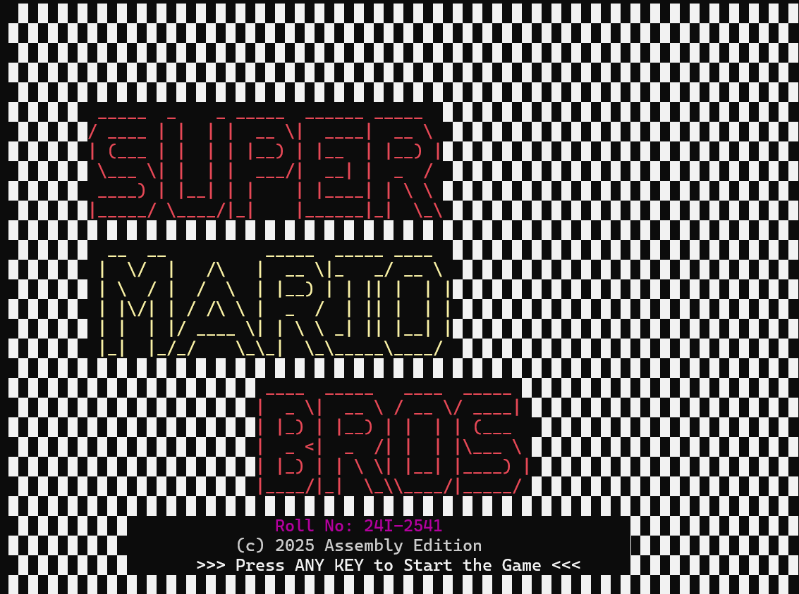
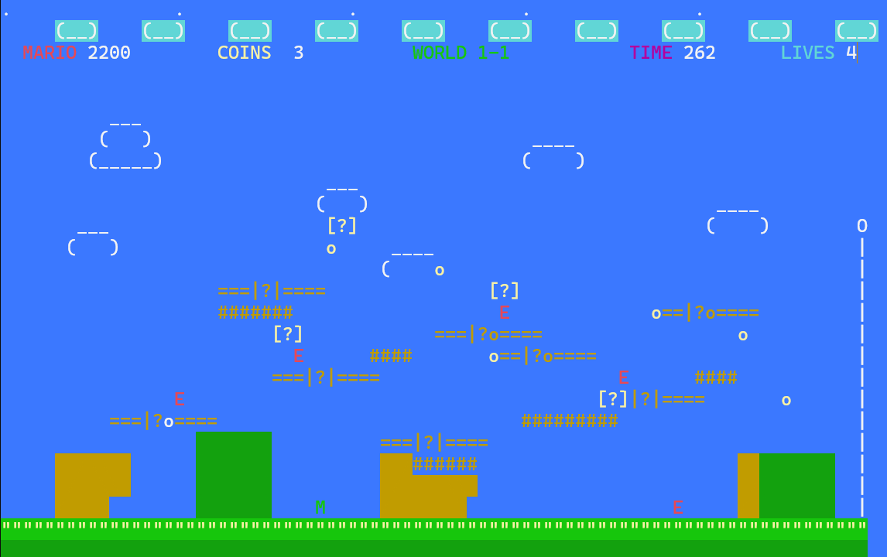
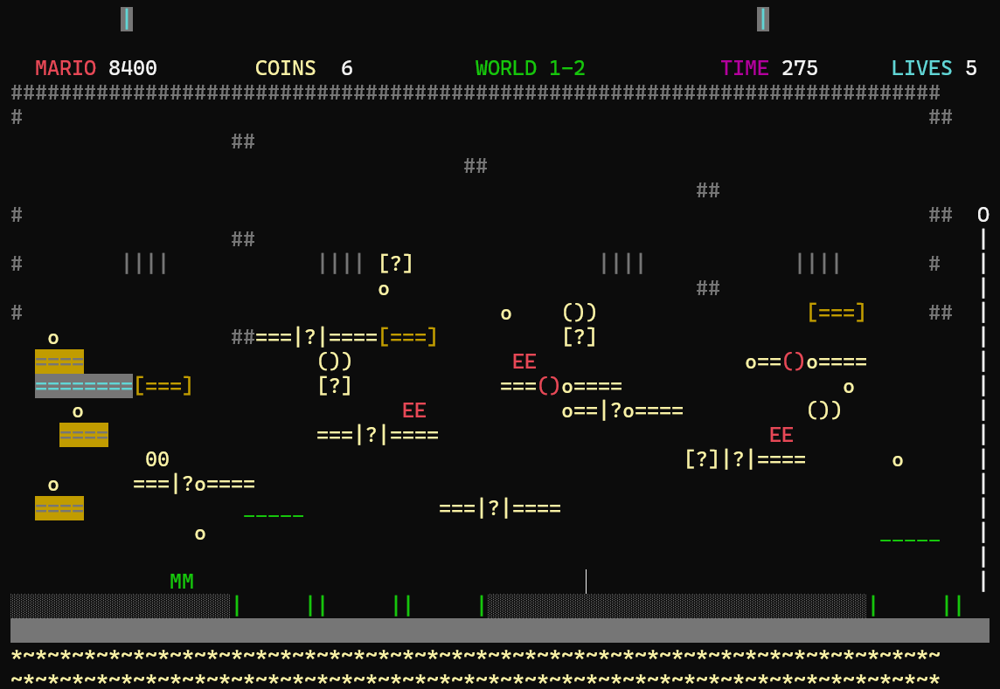
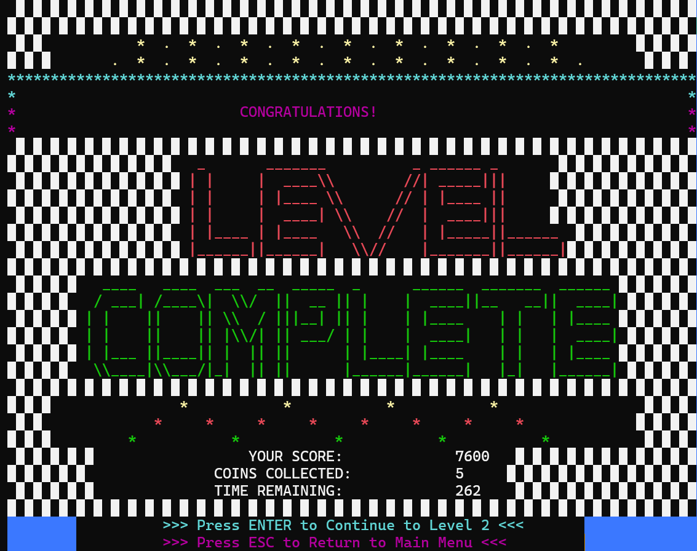
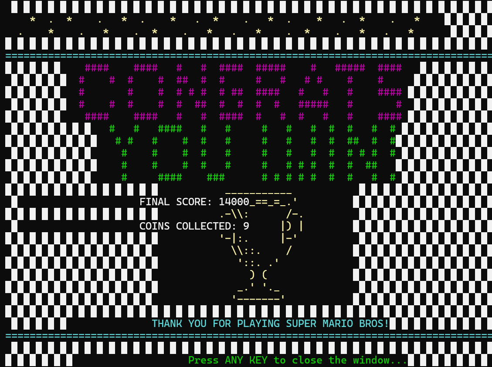

<div align="center">

# Super Mario Bros: Assembly Edition

A two-level, Mario-style platformer for the Windows console, written entirely in x86 assembly language.


</div>

## Overview

This is a console platformer inspired by Super Mario Bros, built as one 7,700-line MASM source file with no game engine or framework. Mario runs, jumps, collects coins, stomps enemies, grabs power-ups and reaches the flagpole across an overworld level and an underground level. Graphics are ASCII characters and console colors, sound effects and looping music go through the Windows `PlaySound` API, and player scores are stored in a text file that feeds an in-game leaderboard. This is a fan-made tribute and is not affiliated with Nintendo.

## Demo

[Watch the demo video](Gameplay.mp4)

| Title screen | Level 1 |
|---|---|
|  |  |

| Level 2 | Level complete |
|---|---|
|  |  |



## Key Features

- **Two levels:** an overworld stage (WORLD 1-1) with sky, clouds, hills, pipes and platforms, and an underground stage (WORLD 1-2) with a tunnel background, a ceiling and an animated lava strip that cycles red and yellow.
- **Movement and physics:** run with `A` and `D`, short jump with `w`, high jump with `W`. Gravity drops Mario onto the highest platform, hill, pipe or the ground beneath him, and pipes block sideways movement.
- **Enemies:** five patrolling enemies per level that walk between fixed left and right limits. In Level 1 a stomp defeats an enemy (+300). In Level 2 the first stomp turns it into a shell (+300) and the second removes it (+500). Touching an enemy from the side costs a life.
- **Power-ups:** extra-life mushrooms (+1 life, +500), golden mushrooms (+1000 and temporary invincibility), and in Level 2 super mushrooms (+1000) that let Mario survive one hit and shrink back instead of losing a life.
- **Coins and a secret area:** coins are worth 200 points each. Level 2 hides a secret area that awards +500 on entry plus three more coins.
- **Lives and timer:** 5 lives and a 300-second countdown per level. Running out of time costs a life, and losing the last life shows the game-over screen.
- **Save, resume and leaderboard:** after entering a name, progress (name, score, level) is written to `players.txt` with Irvine32 file routines, up to 50 players. The top 5 scores are shown in the High Score menu, and a returning player saved on Level 2 gets a resume or restart prompt.
- **Menus and screens:** animated welcome screen, main menu, instructions, pause menu, level-complete screen, game-over screen, and an ASCII trophy end screen.
- **Sound:** looping background music, plus separate effects for jump, coin, enemy defeat, power-up, lost life and flagpole. Jump, coin, enemy and power-up effects use `SND_NOSTOP` so they do not cut off the music.

## Tech Stack

| Area | Technology |
|---|---|
| Language | x86 (32-bit) assembly language |
| Assembler | MASM syntax (`PROC`, `INVOKE`, `PROTO`, `LOCAL`) |
| Library | Irvine32 (console I/O, colors, `Gotoxy`, `ReadKey`, `Delay`, file routines) |
| Audio | Windows multimedia API `PlaySoundA` from `winmm.lib`, WAV files |
| Platform | Windows console (`kernel32.lib`, `winmm.lib`) |
| Persistence | Plain text file, `players.txt` |

## Project Structure

```text
super-mario-assembly/
  24I-2541_Mario.asm       Complete game: data section, 100+ procedures, main loop
  Resources/               WAV audio: background, jump, coin, enemy, powerup, lifelost, flagpole
  Screenshots/             Title, Level 1, Level 2, level complete and game complete screens
  Gameplay.mp4             Gameplay recording
  README.md
```

Inside `24I-2541_Mario.asm`: the `.data` section holds all sprites, level layouts and game state, and `main` runs the game loop (HUD, timer, enemy updates, collision checks, then `ReadKey` input).

## Getting Started

### Prerequisites

- Windows
- Visual Studio with the C++ desktop workload (provides MASM, `ml.exe`)
- The Irvine32 library and header (`Irvine32.inc`) from the support files of Kip Irvine's "Assembly Language for x86 Processors", set up as a 32-bit (x86 / Win32) MASM project

The repository does not include a Visual Studio project or build script, so you create the project yourself.

### Installation

```bash
git clone https://github.com/shahramshafiq/super-mario-assembly.git
cd super-mario-assembly
```

1. In Visual Studio, create a MASM project that is configured for Irvine32 and set to the x86 (Win32) platform.
2. Add `24I-2541_Mario.asm` as the only source file. The file already links `kernel32.lib` and `winmm.lib` through `INCLUDELIB`.
3. Build the project to produce the executable.
4. Copy all `.wav` files from `Resources/` into the folder the game runs from. The code opens them by bare file name (for example `background.wav`), so they must sit in the working directory next to the executable.

### Run

Start the executable from Visual Studio (Ctrl+F5) or from a console whose working directory contains the WAV files. Use a console window of at least 80 columns by 32 rows, because the game draws on an 80-column grid and uses rows up to 31. `players.txt` is created in the working directory the first time a score is saved.

## Usage

| Key | Action |
|---|---|
| `A` / `D` | Move left / right |
| `w` | Short jump |
| `W` (Shift + w) | High jump |
| `P` | Pause (then `1` resume, `2` main menu) |
| `X` | Exit the game |
| `1` to `4` | Main menu: start game, high score, instructions, exit |
| `B` | Back to the main menu from Instructions or High Score |
| `Enter` / `Esc` | On the level-complete screen: continue to Level 2 / return to the main menu |

Typical session: press any key on the welcome screen, choose `1` to start, type a player name, collect coins and power-ups, stomp enemies, and reach the flagpole on the far right. Finishing Level 2 shows the final score and coin count.

## Limitations and Roadmap

- There is no project file or build script in the repository, so the Irvine32 setup is manual. A `Makefile` or a ready-made Visual Studio project would make building a one-step process.
- Jumps are animated inside blocking loops, so Mario cannot be steered in mid-air.
- Level layouts, enemy positions and coin positions are hard-coded in the data section rather than loaded from a level file.
- Audio is WAV only, and the background track is large (about 32 MB); a shorter or lower-sample-rate loop would shrink the repository.

## Author

**Shahram Shafiq** - [GitHub](https://github.com/shahramshafiq) | [LinkedIn](https://www.linkedin.com/in/shahramshafiq/)
